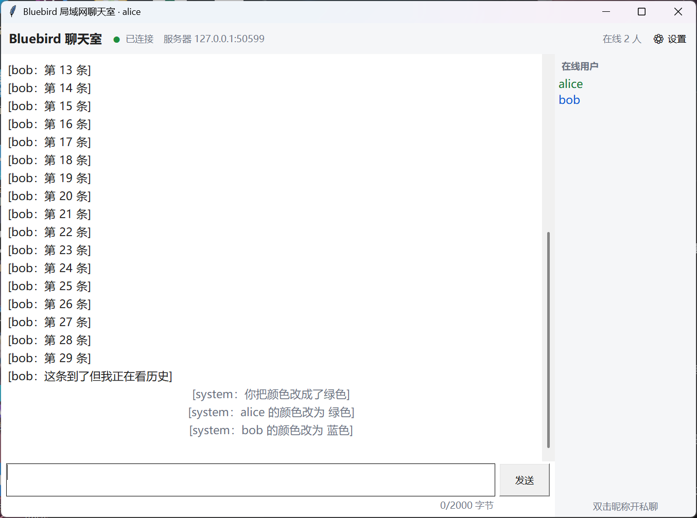
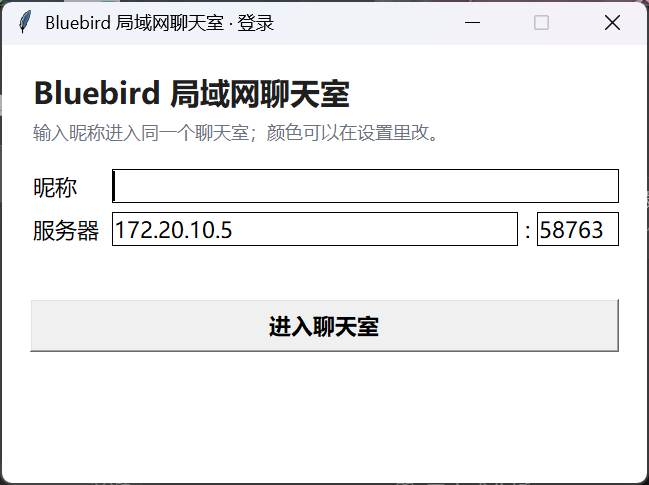
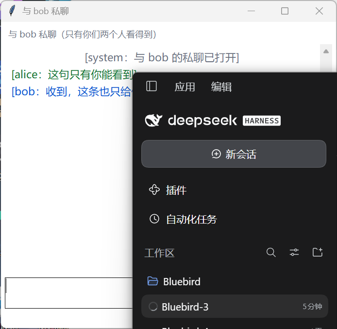
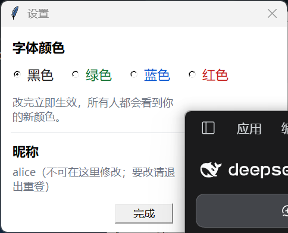
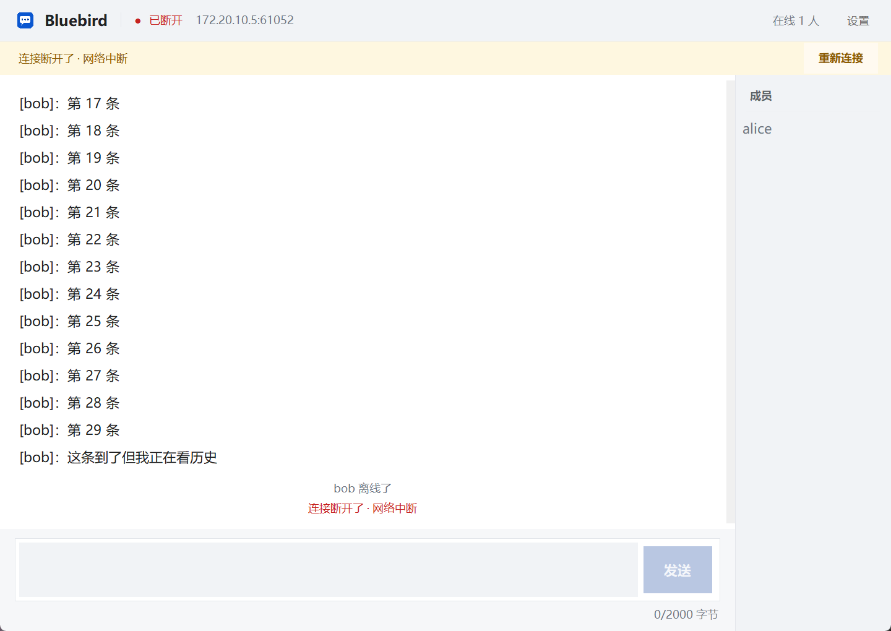

# Bluebird · 局域网聊天室

> 同一个 Wi-Fi 下，两台电脑各输一个昵称就能聊起来。
> C/S 架构 · TCP 长连接 · 自定义 8 字节帧头 + UTF-8 JSON · asyncio · tkinter
> **零第三方依赖**，Windows 上双击就能跑。



## 5 分钟上手（Windows）

### 0. 准备

- Windows 10 / 11
- Python 3.10 或更高版本（推荐 3.13），安装时勾选 **Add python.exe to PATH**
- 不需要 `pip install`：整个项目只用标准库

确认 Python 可用（`py -3` 是 Windows 的 Python 启动器，会选机器上最新的 3.x；没有它就把下面的 `py -3` 换成 `python`）：

```powershell
py -3 -V
```

### 1. 拿到代码

```powershell
git clone https://github.com/wiyij/Bluebird.git
cd Bluebird
```

不想用 git 的话，在 GitHub 页面点 **Code → Download ZIP**，解压后进入目录即可。

### 2. 启动

双击 **`启动聊天室.bat`**：8888 上没有服务端就先在后台起一个，然后弹出登录窗。

> 第一次运行 Windows 可能弹防火墙提示，点「允许访问」。
> 仓库里没有 `.lnk` 快捷方式（它存的是绝对路径，换台机器就失效）；想要桌面图标，
> 双击 `创建桌面快捷方式.bat` 生成一个。

### 3. 登录

| 填什么 | 怎么填 |
| --- | --- |
| 昵称 | 1—16 个字：中文、字母、数字、下划线；**同一时间只能有一个人用** |
| 服务器 | 本机试玩填 `127.0.0.1`；连别人填对方电脑的局域网 IP |
| 端口 | `8888` |

点「进入聊天室」。

### 4. 开始聊

- **多开几个窗口就是多个人**：再双击两次 `启动聊天室.bat`，换昵称登录
- 群聊：输入框打字，**Enter 发送**，**Shift+Enter 换行**
- 私聊：**双击右侧「成员」里的昵称**，弹出独立小窗，主聊天室不显示私聊内容
- 改颜色：右上角 **设置**，黑 / 绿 / 蓝 / 红四选一，立即生效
- 消息格式是 `[昵称]：内容`；自己的消息靠右，系统提示居中
- 断线：黄色横幅 + 红点，点「重新连接」回到登录窗重新登录
- 单条消息上限 **2000 字节**（一个汉字 3 字节、emoji 4 字节），超了会提示分段发送

### 5. 退出

关掉窗口即可。最后一个客户端离开 **2 分钟**后，服务端自动退出，不会留后台进程。

## 两台电脑 / 局域网

1. **服务端那台**：双击 `启动聊天室.bat`，然后查自己的局域网 IP：

   ```powershell
   ipconfig
   ```

   看「WLAN」或「以太网」里的 IPv4，例如 `192.168.1.10`。

2. **另一台**：双击 `启动聊天室.bat`，把登录窗里的「服务器」改成 `192.168.1.10`，端口 `8888`。
   如果只想开客户端、不在本机再起一个服务端：

   ```powershell
   py -3 start_chat.py --no-server
   ```

3. **两台必须连同一个局域网 / 同一个热点。** 连不上先在客户端那台测：

   ```powershell
   Test-NetConnection 192.168.1.10 -Port 8888
   ```

   - 很快返回 `TcpTestSucceeded : False` → 服务端没起，或端口不对（登录窗会提示「连接被拒绝」）
   - 一直卡住、最后超时 → 防火墙拦了，或两台不在同一网段

4. 放行 8888 入站（在服务端那台，管理员 PowerShell）：

   ```powershell
   New-NetFirewallRule -DisplayName "Bluebird 8888" -Direction Inbound -Protocol TCP -LocalPort 8888 -Action Allow
   ```

## 界面速览

| 登录 | 私聊 |
| --- | --- |
|  |  |
| **设置（四色）** | **断线横幅** |
|  |  |

## 常见问题

| 现象 | 原因 | 怎么办 |
| --- | --- | --- |
| 双击 `.bat` 一闪而过 / 没反应 | 没装 Python，或安装时没勾 PATH | 装 Python 3.10+ 并勾 **Add python.exe to PATH**；日志在 `logs/launcher.log` |
| 「这个地址上没有聊天室在运行」 | 服务端没启动，或端口填错 | 先双击 `启动聊天室.bat`；确认端口 `8888` |
| 一直「连接超时」 | 防火墙 / 两台不在同一网段 | 按上面的命令放行 8888；连同一个 Wi-Fi |
| 「该昵称已有人使用」 | 昵称在线唯一 | 换一个昵称，或等对方退出 |
| 8888 端口被占用 | 旧服务端没退，或别的程序占着 | `netstat -ano | findstr 8888` 找到 PID 结束掉；或换端口启动 |
| 关掉重开后颜色变黑、聊天记录没了 | 设计如此：零持久化 | 每次登录都是全新会话，不存账号和历史 |
| 私聊提示对方不在线 | 不暂存离线消息 | 等对方上线再发 |
| 关掉窗口后还有 python 进程 | 服务端在等 2 分钟空房退出 | 正常；不想等就 `taskkill /PID … /T /F` |
| 演示时改了代码但行为没变 | 8888 上还跑着旧服务端 | 先结束旧进程，再双击启动 |

## 功能

- 昵称登录（在线唯一，无账号、无密码、无数据库）
- 一个公共聊天室 + 一对一私聊（独立窗口，主窗不串）
- 在线名单实时增删，双击昵称开私聊
- 四色字体（黑 / 绿 / 蓝 / 红），改色广播给所有人，重登回黑
- 心跳 15 s、45 s 判死、5 s 扫描；断线横幅 + 重新登录
- 中文、英文、emoji、日文原样传输（UTF-8，单条 ≤ 2000 字节）
- 10 条/秒限流、64 KB 帧上限、未登录 / 坏帧 / 超时的统一处理

## 进度

| 模块 | 状态 |
| --- | --- |
| 应用层协议 v2（15 种类型、10 个错误码） | ✅ 已冻结（tag `proto-v2`） |
| 帧编解码 + 93 条单元/联调测试 | ✅ |
| 服务端：昵称登录、群聊、一对一私聊、颜色广播、上下线通知 | ✅ |
| 服务端：登录时限 10 s、未登录 1006、滑动窗口限流 2002、系统消息 `CHAT_SYSTEM` | ✅ |
| 心跳与超时踢除（15 s / 45 s / 5 s 扫描） | ✅ |
| 断线与写失败处理（写超时 5 s、立即断开、不留幽灵用户） | ✅ |
| 客户端网络层（独立线程 + 事件队列，CLI 与 GUI 共用） | ✅ |
| GUI：登录窗 + 四区主窗 + 私聊小窗 + 设置面板 + 断线横幅 | ✅ |
| 命令行客户端（`/w` 私聊、`/color` 改色、`/who`、心跳保活） | ✅ |
| 验收用例 T01—T13（《结果示例》第 5 章） | T01—T12 已在协议／CLI／GUI 层验过（见 `docs/test/D3.md`）；T13「换网段」的**换 IP 部分**已在手机热点上验完，只剩「第二台机器」现场走一遍 |

## 开发环境

运行程序不需要任何第三方包（只用标准库）；**跑测试**需要 pytest 与 pytest-asyncio。
本机开发用的是 Python 3.13.7，命令里的 `py -3.13` 可以按自己的版本换成 `py -3` / `python`。
仓库里不包含 `.venv`（被 `.gitignore` 排除）；想用虚拟环境就自己建一个：

```powershell
py -3 -m venv .venv
.venv\Scripts\Activate.ps1
py -3 -V                    # 3.10+
```

控制台默认 GBK，打印 emoji 会炸；所有入口都调 `shared.console.setup_console()`
把三个标准流切到 UTF-8。

## 目录

```
Bluebird/
├─ 启动聊天室.bat    双击即用：起服务端 + 打开登录窗（不需要快捷方式、不需要装依赖）
├─ 创建桌面快捷方式.bat  双击在仓库根与桌面各生成一个 .lnk（.lnk 不进仓库，见下）
├─ start_chat.py    一键启动：没有服务端就先起一个，再打开登录窗（快捷方式指向它）
├─ assets/
│   └─ bluebird.ico/.png  快捷方式图标与界面 Logo（同一张图，tools/make_icon.py 生成）
├─ shared/        协议、配置、错误码（前后端共用）
│   ├─ config.py        命令行参数：--host / --port / --max-frame / --log-level
│   ├─ protocol.py      帧编解码、MsgType、颜色常量、ProtocolError
│   ├─ errors.py        10 个错误码 + 中文文案 + FATAL_CODES
│   └─ console.py       Windows 控制台 UTF-8 适配
├─ server/
│   ├─ server.py        登录、群聊、私聊、颜色、上下线
│   ├─ router.py        type → 处理函数（装饰器注册；未知类型回 2004）
│   ├─ heartbeat.py     心跳判死的纯函数（45 s = 3 × 15 s）
│   ├─ ratelimit.py     单用户滑动窗口（10 条/秒）
│   └─ connection.py    单连接封装：nickname / color / last_active / send / abort
├─ client/
│   ├─ net.py           网络层：一条连接 + 心跳 + 事件队列（CLI 与 GUI 共用）
│   ├─ cli.py           命令行客户端（只做渲染）
│   ├─ gui.py           图形界面入口：登录窗、DPI、事件泵、断线回登录
│   ├─ chatui.py        四区主窗：顶栏 / 消息区 / 在线列表 / 输入区
│   ├─ dialogs.py       私聊窗（Toplevel）与设置面板（四色）
│   └─ ui.py            界面公共零件：配色、字体、输入框、按钮、只读消息框
├─ tools/
│   ├─ procutil.py      起停子进程（Windows 上要杀整棵树，否则启动器留下真进程）
│   ├─ tap.py           应用层抓包代理（按协议拆帧，逐帧记录十六进制）
│   ├─ capture_d1.py    D1 取证：一条命令起服务端 + tap + 两个客户端
│   ├─ capture_d2.py    D2 取证：三条连接各一个 tap，证明私聊不外泄（TC-05）
│   ├─ tap_to_pcap.py   tap 日志 → 可在 Wireshark 里看的 pcap（载荷原样，头部重建）
│   ├─ verify_d1.py     D1 验收：13 项协议层判据
│   ├─ verify_d1_cli.py D1 验收：两个真实 CLI 客户端互发
│   ├─ verify_d2.py     D2 验收：20 项协议层判据（登录／名单／群聊／私聊／限流）
│   ├─ verify_d2_cli.py D2 验收：三端真实 CLI
│   ├─ verify_robust.py 健壮性验收：心跳判死、慢客户端、坏帧容错、断线退出
│   ├─ verify_d3_gui.py D3 验收：开真窗口走查 34 项，可 --shots 出截图、--host 换地址
│   ├─ verify_d3_net.py D3 验收：T13 换网复验（走真实网卡，不经过 127.0.0.1）
│   ├─ make_shortcut.py 生成「Bluebird 聊天室」快捷方式（仓库根 + 桌面）
│   ├─ make_icon.py     生成快捷方式图标与界面 Logo（assets/bluebird.ico/.png）
│   └─ build_d3_doc.py  生成桌面工作汇总 docx
├─ tests/               协议 23 + 限流 4 + 路由 6 + 心跳 6 + 服务端 32 + 客户端 16 + 界面 6 = 93 条
└─ docs/
    ├─ protocol.md      应用层协议 v2（唯一事实源）
    ├─ 三阶段实施路线.md
    ├─ pcap/            抓包日志（v1/v2）与帧结构配图
    ├─ gui/             D3 界面截图（登录 / 主窗 / 私聊 / 设置 / 断线）
    └─ test/            D1/D2/D3 验收记录与证据
```

## 手动启动（不用 .bat）

先起服务端，再开客户端窗口：

```powershell
py -3 -m server.server                          # 终端 1：监听 0.0.0.0:8888
py -3 -m client.gui --name alice                # 终端 2：弹出登录窗
py -3 -m client.gui --name bob                  # 终端 3（换机器时 --host 填服务端 IP）
```

登录窗里填昵称与服务器地址 → 进入 → 双击右侧昵称开私聊 → 设置里换颜色。

只开客户端、连别人的服务端：

```powershell
py -3 start_chat.py --no-server
py -3 start_chat.py --host 192.168.1.10
```

## 命令行客户端

脚本、抓包、三端快速验证时用：

```powershell
py -3 -m server.server                          # 终端 1：监听 0.0.0.0:8888
py -3 -m client.cli --name alice                # 终端 2
py -3 -m client.cli --name bob --color blue     # 终端 3（可换机器，--host 填服务端 IP）
```

进去先登录（昵称在线唯一），然后：

```
直接输入            群聊，格式 [昵称]：内容
/w bob 在吗         私聊 bob
/color green        改自己的颜色（black / green / blue / red，所有人可见）
/who                看在线名单
/quit               退出
```

## 服务端行为

| 收到 | 动作 |
| --- | --- |
| `LOGIN_REQ` | 校验昵称格式与重名 → 回 `LOGIN_RESP` → 下发 `USER_LIST` → 广播 `USER_JOIN` 与一条 `CHAT_SYSTEM` |
| `LOGIN_REQ` 缺字段／类型不对 | 回 `LOGIN_RESP{2003}` 后断开（协议 §0 纪律 1） |
| 登录前发别的帧 / 10 s 不登录 | 分别回 `1006` 后断开、静默断开 |
| `CHAT_GROUP` | 限流通过 → 补 `seq/from/server_ts` → 广播给所有人（含发送者） |
| `CHAT_PRIVATE` | 按 `to` 单投；对象离线回 `3001`，不暂存 |
| `SET_COLOR` | 校验四色 → 广播 `USER_COLOR` |
| `PING` | 回 `PONG`；任何帧都刷新 `last_active` |
| 超过 10 条/秒 | 回 `2002`，这一条不扇出（滑动窗口，`server/ratelimit.py`） |
| 45 s 一个帧都没收到 | 判死：`USER_LEAVE{reason:"disconnect"}` + 系统提示「超时下线」 |
| 写不进去（对端不读／已断） | 5 s 写超时后立刻断开，绝不把整个房间拖住 |
| 未知类型 | 回 `ERROR(2004)`，连接保持 |
| 坏 JSON | 回 `2003` 容错一次，第二次才断 |
| 坏 magic / 版本不符 / 超长帧 | 前两者分别静默断开与回 `1003`，超长静默断开 |

## 测试

先装测试依赖（只跑程序不需要）：

```powershell
py -3 -m pip install pytest pytest-asyncio
```

下面的命令用仓库本地的 `.venv` 解释器；没有 venv 的话，把
`.venv\Scripts\python.exe` 换成 `py -3` 即可。

```powershell
.venv\Scripts\python.exe -m pytest                 # 93 passed
.venv\Scripts\python.exe tools\verify_d3_gui.py    # D3 界面走查 34 项（自己起服务端，约 20 秒）
.venv\Scripts\python.exe tools\verify_d3_gui.py --shots   # 顺便把截图写到 docs/gui/
.venv\Scripts\python.exe tools\verify_d3_gui.py --host 172.20.10.5   # 换网复验：走真实网卡
.venv\Scripts\python.exe tools\verify_d3_net.py    # T13 换网复验 11 项（自动取本机局域网 IP）
.venv\Scripts\python.exe tools\verify_robust.py    # 13 项：心跳判死、慢客户端、坏帧容错、断线退出
.venv\Scripts\python.exe tools\verify_robust.py --slow   # 再加 3 项：真实 15/45 s 参数下空闲 50 s（约 1 分钟）
.venv\Scripts\python.exe tools\verify_d2.py        # 三端协议层 20 项
.venv\Scripts\python.exe tools\verify_d2_cli.py    # 三端真实 CLI（需先起服务端）
.venv\Scripts\python.exe tools\capture_d2.py       # 私聊隔离抓包（TC-05，自起服务端与三个 tap）
```

## 协议速览

```
[ magic 2B ][ ver 1B ][ type 1B ][ length 4B 大端 ][ body: JSON, UTF-8 ]
  0x4348      0x02                                               ≤ 65528
```

15 种消息类型、10 个错误码、5 条关键时序，见 [docs/protocol.md](docs/protocol.md)。

## 文档

- [docs/protocol.md](docs/protocol.md) —— 应用层协议 v2（冻结版）
- [docs/test/D1.md](docs/test/D1.md) —— D1 抓包记录（协议 v2）与 Wireshark 补图步骤
- [docs/test/D1-验收报告.md](docs/test/D1-验收报告.md) —— D1 验收结论与证据清单
- [docs/test/D2.md](docs/test/D2.md) —— D2 三端联调、TC-01—TC-08 与限流/登录硬化记录
- [docs/test/D2-审查.md](docs/test/D2-审查.md) —— D2 三轮审查记录（第三轮修掉 5 处会在 D3 引爆的隐患）
- [docs/test/D2-robust-evidence.txt](docs/test/D2-robust-evidence.txt) —— 健壮性判据的实际输出
- [docs/test/D2-capture.txt](docs/test/D2-capture.txt) —— 私聊隔离的字节级证据（carol 的流里 0 条 0x11）
- [docs/test/D3.md](docs/test/D3.md) —— D3 界面与健壮性：四区布局、三个决定、四个坑、换网复验
- [docs/test/D3-验收报告.md](docs/test/D3-验收报告.md) —— D3 复验结论、问题清单与 D4 缺口
- [docs/test/D3-gui-evidence.txt](docs/test/D3-gui-evidence.txt) —— 界面走查 34 项的实际输出
- [docs/test/D3-net-evidence.txt](docs/test/D3-net-evidence.txt) —— T13 换网复验 11 项（真实网卡、非回环）
- [docs/gui/](docs/gui) —— 登录窗 / 主窗 / 私聊窗 / 设置 / 断线 五张截图
- [docs/三阶段实施路线.md](docs/三阶段实施路线.md) —— 三阶段施工顺序与每步判据
